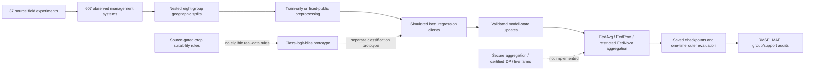

# Steps 4–6: novelty, questions and mathematical-method gate

Checked 2026-10-15 against `paper2/knowledge.py`, `knowledge_training.py`,
`federated.py`, `restart/regression_training.py`, archived run audits, and the
26-source `literature_evidence_matrix_v2.md`. This is an implementation-grounded
method note, **not** a claim that the proposed KG-FCR algorithm has been
validated. The active study is conditional harvest dry-matter regression.

## 4. Exact knowledge mechanism and novelty decision

The *prototype* rule bank represents class-aligned, crop--feature suitability
as source-documented trapezoids `(a,b,c,d)` in original feature units. Rules
carry weights and explicit region/season/stage/water scope. A rule applies
only when the raw value was actually observed and its scope matches; an
imputed value does not become evidence. Independent source hashes, feature
contracts, taxonomy, approval declarations and scope are required by the
software gate, but these checks are not a scientific validation of a rule.
The current real-data gate reports `BLOCKED_FOR_REAL_DATA_GUIDANCE`.

For a rule (r) on class (c), feature (j), with observed raw value (v_j),
the implemented suitability is

\[
s_r(v_j)=\operatorname{clip}_{[0,1]}
\left(\min\left\{\frac{v_j-a_r}{b_r-a_r},
                     \frac{d_r-v_j}{d_r-c_r}\right\}\right).
\]

For applicable, observed rules (R_c(x)), the class score is a weighted mean

\[
q_c(x)=\frac{\sum_{r\in R_c(x)}w_r s_r(v_{j(r)})}
              {\sum_{r\in R_c(x)}w_r},
\]

and **(q_c=0.5)** when no rule covers that class and sample. The prototype
`KnowledgeGuidedMLP` changes class logits by

\[
z'_c(x)=z_c(x;\theta)+\alpha\,[q_c(x)-0.5],\qquad \alpha\ge0.
\]

Local training uses ordinary cross-entropy on (z'), so guidance changes
local gradients when nonzero. It is **not** a separate knowledge-loss term,
attention mechanism, learned crop profile, client-adaptive rule weight, or
knowledge-aware aggregation. `alpha=0` gives the plain MLP. No eligible
real-data rule bank or independently selected nonzero alpha exists for the
active cereal--legume regression task. The bank is a classification design;
this 607-system dataset has a continuous harvest target and no observed
counterfactual best-crop labels.

Incomplete coverage is neutral by construction (`q=0.5`). A rule outside its
documented scope is ignored. A *wrong but approved* rule can still bias a
prediction; there is no automatic conflict detector, local override, or
regional rule-learning mechanism. That is a scientific risk, not a solved
heterogeneity feature.

| Dimension | Verified comparison |
|---|---|
| Existing methods | FedAvg averages local parameters; FedProx changes the local objective; FedNova normalizes variable-step local updates. Federated agricultural yield and crop-recommendation systems and knowledge-guided agricultural models already exist (see literature matrix). |
| Unresolved limitation in this study | Primary central and federated neural results were weak and multiple design changes in the later fixed-public study were not isolated. Independent knowledge suitability and ranking labels are absent. |
| Prototype difference | Static class-specific logit bias from a source-gated suitability rule bank **during local classification**; unchanged standard server aggregation. This is an implementation detail, not yet an established novel method. |
| Hypothesized benefit | May affect gradients where valid class-specific rules cover an input; no reason to predict a universal gain or benefit under out-of-scope sites. |
| Evidence required | Approved independent agronomic rules with exact units/scope, comparable crop labels, frozen alpha/ablation selection, matched client partitions, held-out geographic performance and adverse-rule tests. None exists for the active regression study. |

**Primary contribution that can be stated now (bounded):** We provide a
versioned, geographically grouped comparison and diagnostic audit of
centralized and simulated federated regressors for retrospective cereal--legume
harvest dry-matter prediction, explicitly separating original, post-hoc
support, and later aggregation-noise evidence. This is an empirical evaluation
contribution, **not** a new KG-FCR algorithm or proof of field usefulness.

Supporting contributions already evidenced: (1) source- and split-audited
eight-group nested evaluation with equal-group, pooled and support-panel
metrics; (2) transparent post-hoc sensitivity/paired geographic analysis;
(3) bounded matched-noise **utility simulation** with conditional, not
end-to-end, privacy accounting. Do not claim numerical superiority or
generality beyond this dataset. A stronger mechanistic contribution requires
the planned controlled ablations.

## 5. Research questions, hypotheses and experiment map

The supplied crop-classification RQs, accuracy and macro-F1 hypotheses are
**not applicable** to the active regression target. The following are the
bounded questions for this study. They are not pre-announced confirmatory
tests because earlier outer outcomes were already exposed; a prospective
new-site study would be needed for confirmation.

| RQ / testable expectation | Evidence available | Missing decisive experiment |
|---|---|---|
| RQ1: Under matched representation, architecture, optimizer and inner-selection budget, what extra t/ha error is attributable to simulated federation? H1 (exploratory): part of the original neural deficit is shared by centralized and federated training, not federation alone. | Primary 320 runs and separate fixed-public stage show a large design-dependent change but confound factors. | Freeze factorial/matched central–FedAvg–FedProx–FedNova ablations and stronger neural search; report effect sizes and budget, including adverse outcomes. |
| RQ2: How does held-out group composition and observed feature support alter ranking? H2 (exploratory): per-group and pooled/equal-group conclusions are sensitive to site composition. | Eight-group panels plus 2,384-run index and leave-one-group sensitivity. | New independent geography with prospective support protocol; existing site-deletion is descriptive only. |
| RQ3: What utility loss and resource cost accompany clipped/noisy aggregation? H3 (exploratory): larger simulated noise worsens regression utility. | 160 matched-noise and 200 earlier privacy-simulation runs; conditional accountant. | Actual per-run communication/time measurement and a separately certified privacy threat model/mechanism. No present security or deployment claim. |

If the intended work is instead KG-FCR crop recommendation, that is a
**separate research program**: define valid crop-choice labels or a defensible
counterfactual decision target, approve independent agronomic rules, freeze
classifier experiments and verify its own privacy/security scope. Do not
rename the current harvest-regression study into KG-FCR.

## 6. Equations matched to current code

For (K) simulated training clients with (n_k) examples, the primary
regression local loss is MSE,

\[
F_k(\theta)=\frac{1}{n_k}\sum_{i\in D_k}
  (f_\theta(x_i)-y_i)^2,\qquad
F(\theta)=\sum_{k=1}^K p_kF_k(\theta),\quad
p_k=\frac{n_k}{\sum_j n_j}.
\]

The later fixed-public equal-client control instead uses (p_k=1/K), so it
targets a different client-weighted objective. This is not merely a change
of optimizer. For primary FedAvg after local training to (\theta_{k,t}),

\[
\theta_{t+1}=\sum_k p_k\theta_{k,t}.
\]

FedProx adds ((\mu/2)\|\theta-\theta_t\|_2^2) **inside each local SGD loss**
before FedAvg-like aggregation; primary (\mu=0.01). The restricted FedNova
implementation in `federated.py` with actual local step counts (s_k) uses

\[
\bar s=\sum_k p_ks_k,\qquad
\theta_{t+1}=\theta_t-\bar s\sum_kp_k
\frac{\theta_t-\theta_{k,t}}{s_k}.
\]

This matches constant shared-learning-rate plain SGD under its documented
restrictions; it is not a general FedNova implementation for arbitrary
momentum, schedules, or weight decay. The prototype knowledge-guided
classification objective is

\[
F^{KG}_k(\theta;\alpha)=\frac{1}{n_k}\sum_{i\in D_k}
  \operatorname{CE}(z(x_i;\theta)+\alpha(q(x_i)-0.5),y_i).
\]

It would use the *same* server aggregation rule as FedAvg/FedProx/FedNova,
chosen separately. There is no term of the form
`classification_loss + lambda * knowledge_loss` in the prototype and no
knowledge-guided regression objective in the completed study.

### Source-matched simulated training pseudocode

```text
Input: frozen geographic partitions, train-only preprocessing, method,
       selected validation-derived settings, seed
Initialize a shared neural model and its schema identity
For each planned round:
    Select configured simulated clients (primary study: all training groups)
    For each selected client, copy the current model
        Train on that client's training rows only
        If method is FedProx, add the proximal term to local loss
        Return model state, actual SGD steps, sample count and identity fields
    Validate client roster, round, schema, base hash, shapes, finiteness and counts
    Aggregate with sample-weighted FedAvg/FedProx or restricted FedNova rule
    Save resumable checkpoint and receipt according to the frozen runner
Restore the validation-selected/refit checkpoint
Perform the permitted outer-test inference once; retain the receipt/cache
```

The optional *synthetic* knowledge-classification path computes source-gated
`q`, adds `alpha(q-0.5)` to logits and then trains locally. It has no approved
real-data execution or production server. The server currently validates raw
individual updates in process. A true secure-aggregation server could not
inspect those updates in the same way; therefore the current pseudocode must
not silently acquire a secure-aggregation step.

### Architecture and evidence boundary



This diagram deliberately does not connect knowledge rules to the completed
regression experiments. The dashed prototype and deployment paths are
non-evidence, not hidden parts of the reported pipeline.
